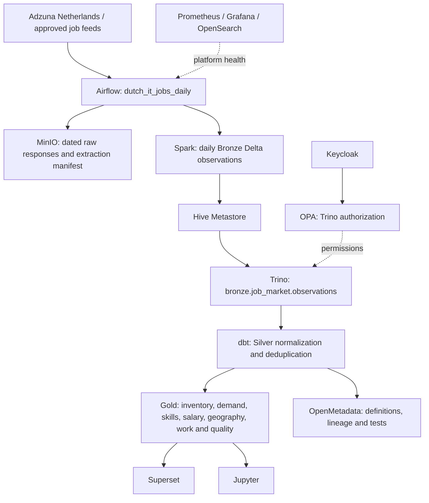

# Architecture: Dutch IT Job Market

One daily job-market pipeline connects the platform's data services. This page describes the active path; optional streaming and vendor integrations are outside the example.

| Layer | Active implementation |
|---|---|
| Sources | `examples/dutch-it-jobs/sources.json`; offline synthetic fixtures or explicitly selected live APIs/feeds |
| Raw evidence | Date-partitioned responses and extraction manifest; restricted storage |
| Bronze | `bronze.job_market.observations`, written idempotently by Spark into Delta |
| Silver | `silver.job_market.stg_job_observations` and `int_job_snapshots` |
| Gold | `gold.job_market.mart_job_*`, materialized and tested through dbt |
| Consumption | Superset dashboard, `/job-market/` sample explorer and Jupyter starter notebook |
| Governance | Keycloak authentication, OPA authorization, OpenMetadata catalog and dbt lineage |
| Operations | Airflow schedule at 05:00 Europe/Amsterdam; extraction manifests and service logs |

[Full walkthrough and data dictionary](../use-cases/dutch-it-job-market.md) · [Data zones](datazones.md) · [Naming](naming.md) · [Identity and authorization](auth.md).
