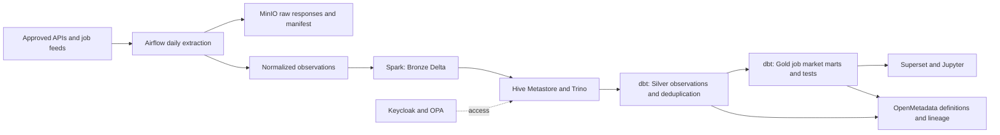

# Dutch IT Job Market

This is the platform's single active use case: collect Dutch IT vacancies every day, preserve their provenance and history, and explore the market across **Data, Cloud, SAP, AI, Software and Security**. The same observations flow through storage, Spark, Hive Metastore, Trino, dbt, Airflow, Superset, OpenMetadata, Jupyter and the portal.

## Start with a reproducible example

```bash
make jobs-demo
make jobs-test
```

The offline demo runs with Python 3.11+ and no cloud account or API credentials. It creates seven deterministic daily snapshots, a SQLite database and a dashboard export. Companies, vacancies and source domains in demo mode are fictional; every row has `is_synthetic=true`. Generated outputs are local artifacts, not national labour-market statistics.

The equivalent direct command is:

```bash
python3 examples/dutch-it-jobs/job_market.py   --mode demo --date 2026-10-28 --days 7 --output-dir /tmp/dutch-it-jobs
```

Open the portal's **Dutch IT jobs** page at `/job-market/` for a clearly labelled synthetic sample with date, domain, location and work-mode filters. Open Superset for the database-backed dashboard after the cluster pipeline completes. Jupyter's `00_dutch_it_job_market.ipynb` starts with SQLite locally and queries the same subject through Trino on the platform.

## The daily journey



Airflow DAG **`dutch_it_jobs_daily`** runs at **05:00 Europe/Amsterdam**, including daylight-saving changes. It has one active run at a time and uses the logical snapshot date for repeatable reruns. Demo mode is explicit and is the default for a fresh installation. Live mode never falls back to synthetic records after a source failure. The object-store `job-market/mode.json` marker pins a deployment to demo or live; choose before the first run. Switching requires a separately configured deployment or a deliberate complete dataset reset.

| Stage | Artifact | What to inspect |
|---|---|---|
| Extraction | `snapshot_date=YYYY-MM-DD/raw/`, `manifest.json` | Source, extraction time, successful/failed requests and coverage |
| Normalization | `snapshot_date=YYYY-MM-DD/normalized/observations.jsonl` | Typed, contact-redacted analytical observations |
| Object storage | `s3://odap-bronze/job-market/raw/snapshot_date=YYYY-MM-DD/attempts/UUID/` plus `current.json` | Immutable source evidence; publish the successful attempt last; restrict raw access |
| Spark Bronze | `bronze.job_market.observations` | One source job observation per snapshot date |
| dbt Silver | `silver.job_market.stg_job_observations` | Standardized dates, arrays, salary units and source lineage |
| Deduplication | `silver.job_market.int_job_snapshots` | One conservative duplicate group per snapshot date, with source arrays |
| Serving | `gold.job_market.mart_job_inventory` and six subject marts | Job details and analytical slices |
| Catalog | OpenMetadata service `trino` | Glossary, ownership, sensitivity, dbt tests and lineage |
| Analysis | Superset slug `dutch-it-job-market`; Jupyter starter | The same Gold tables, under the user's permissions |

For an existing platform installation:

```bash
make jobs-image       # build the runtime image and load it into the local cluster
make jobs-run         # run the same end-to-end pipeline manually
```

The runtime's direct container command is `python /opt/job-market/runtime.py all --date YYYY-MM-DD --mode demo`. Cloud deployments must publish the runtime image to their configured registry before scheduling it. The platform remains a reference implementation; check the Airflow scheduler and image availability in your environment before expecting unattended runs.

## Live sources

The live adapter uses the [Adzuna Jobs API](https://developer.adzuna.com/overview) for the Netherlands (`nl`) with separate keyword searches for the six domains. Adzuna aggregates job advertisements; coverage is bounded by the configured searches and page limits. Register an application and supply credentials through the environment or the Kubernetes source Secret described beside the runtime configuration:

```bash
export ADZUNA_APP_ID='your-application-id'
export ADZUNA_APP_KEY='your-application-key'
python3 examples/dutch-it-jobs/job_market.py   --mode live --date 2026-10-28 --output-dir /tmp/dutch-it-jobs-live
```

The [source registry](../../examples/dutch-it-jobs/sources.json) also supports configured RSS feeds and pages containing schema.org `JobPosting` JSON-LD. Add only URLs that the operator is permitted to retrieve. No arbitrary Dutch job-board HTML selectors or fictional live feeds are enabled by default. The adapter uses bounded pagination, timeouts, retries and pacing; inspect the manifest for failures, limits and partial coverage. Do not place API keys in source configuration or commit generated raw data.

For scheduled cluster extraction, configure the optional `job-market-api-credentials` Secret from your environment and choose live mode before the first data run:

```bash
kubectl -n odap-platform create secret generic job-market-api-credentials \
  --from-literal=ADZUNA_APP_ID="$ADZUNA_APP_ID" \
  --from-literal=ADZUNA_APP_KEY="$ADZUNA_APP_KEY"
# Set JOB_MARKET_MODE: live in platform/11-airflow/job-market-settings.yaml,
# then deploy that configuration. For a manual cluster run:
JOBS_MODE=live make jobs-run
```

The runtime image packages the source registry. Rebuild and publish it after changing configured sources. Do not mix an existing synthetic object-store dataset with live mode; the mode marker rejects that switch.

Live source descriptions can be abbreviated, salaries can be absent or estimated, and some providers do not supply full employer job descriptions. Nulls represent unavailable facts. A daily run observes what the configured sources returned at that time; it does not reconstruct an earlier day simply because `--date` names that day.

## What can be analysed

| Gold model | Questions it answers |
|---|---|
| `mart_job_inventory` | Which jobs are in the latest observed snapshot? Title, employer, place, seniority, contract, skills, salary, provenance and dates |
| `mart_job_demand_daily` | How many distinct observed jobs are there per day and domain? |
| `mart_job_skills` | Which technologies and skills are requested, by domain and date? |
| `mart_job_salary` | What annual EUR salary ranges are advertised, with reported and estimated amounts separated? |
| `mart_job_geography` | Where are observed roles located? |
| `mart_job_work_arrangements` | How do work mode, employment type and contract type vary? |
| `mart_job_source_quality` | Which sources supplied observations, salary data, classifications and duplicate groups? |

A Cloud Security Engineer may belong to both Cloud and Security. Domain counts and skills counts overlap and **must not be added to obtain a national total**. Headline vacancy counts use deduplicated jobs. Source quality counts use source observations so duplicate listings remain auditable.

## Observation data dictionary

| Field | Meaning and treatment |
|---|---|
| `job_id` | Stable source-job identity; the same listing keeps its ID across snapshots |
| `source`, `source_job_id` | Provider identity and original listing ID |
| `canonical_url` | Original job link, with tracking removed where supported |
| `duplicate_group_id` | Conservative normalized company + title + city key for cross-source deduplication; possible false matches and missed matches remain a limitation |
| `snapshot_date` | Logical observation date used to partition repeatable runs |
| `observed_at` | Actual retrieval/observation time in UTC, distinct from publication |
| `title`, `company` | Advertised role and employer; no inferred employer enrichment |
| `city`, `province`, `country_code` | Available geography, restricted to Dutch jobs (`NL`) |
| `latitude`, `longitude` | Coordinates supplied by the source when available; no invented geocodes |
| `description_text` | Plain text for analytics; email addresses and phone numbers redacted |
| `domains` | Deterministic multi-label taxonomy: `data`, `cloud`, `sap`, `ai`, `software`, `security` |
| `skills` | Recognized technologies/skills from the supplied text; absence does not prove a skill is not needed |
| `seniority` | Stated or text-classified level, otherwise unknown |
| `employment_type`, `contract_type` | Employment arrangement and contract duration, where stated |
| `work_mode` | Remote, hybrid or onsite where supported by source text; unknown otherwise |
| `hours_min`, `hours_max` | Stated weekly hours; missing hours remain null |
| `salary_min`, `salary_max` | Original numeric bounds; missing bounds remain null |
| `salary_currency`, `salary_period` | Original currency and unit (`year`, `month`, `hour` or unknown) |
| `salary_is_estimated` | Provider salary estimate flag; estimates are not presented as employer-reported pay |
| `salary_year_min`, `salary_year_max` | EUR/year values: annual unchanged, monthly × 12; no assumed holiday allowance, bonus or hours |
| `language`, `education` | Requirements detected in supplied text; unknown when unavailable |
| `published_at`, `expires_at` | Source publication and expiry dates, when supplied |
| `is_synthetic` | Explicit marker separating reproducible examples from live observations |

Hourly rates and non-EUR or unknown-unit amounts are retained in original form and excluded from annual salary comparisons. Annualized monthly pay does not establish full-time-equivalent pay: contracted hours can differ. Salary coverage and sample size belong alongside any comparison; the sample is not a representative wage survey.

## History, deduplication and quality

Each date keeps a separate snapshot. Reprocessing a date replaces that partition rather than appending duplicate daily observations. Cross-source deduplication is conservative; source listings and links remain available for audit. The latest inventory describes the latest successful observed snapshot. A job disappearing from a bounded search is **not** evidence that it closed; no fabricated closure date or vacancy duration is produced.

Cluster extracts write immutable attempt directories containing `raw/`, `normalized/observations.jsonl` and `manifest.json`. Only after the entire successful attempt is uploaded does the date-root `current.json` pointer publish it for Spark. Failed attempts do not replace the previous successful pointer.

Inspect the run manifest before interpreting trends. A smaller count can reflect a failed source, changed pagination limits or changed searches. Publication dates and observation dates answer different questions. The dbt build checks keys, required fields, domains, snapshot uniqueness and salary consistency before downstream catalog and dashboard refresh; ingestion unit tests exercise normalization, privacy, failures and repeatability. Marts are materialized before their tests run, so an existing dashboard can query updated tables during a build. This reference has no atomic all-mart promotion or rollback layer.

## Governance and operations

Keycloak authenticates people; OPA authorizes their Trino access. Analysts consume Gold job-market tables. Raw payloads can contain recruiter contact details and stay restricted to operational/stewardship roles. The analytical description strips contact information, and the pipeline collects no CVs or applicant profiles. Restricted raw storage does not mean arbitrary republishing is permitted: source terms govern reuse.

The same use case is visible in OpenMetadata through the Job Market glossary and dbt metadata. Use dbt lineage to follow a salary chart to its source observation. Check Airflow task logs and extraction manifests for source errors, Prometheus/Grafana for service health, and OpenSearch for platform logs. Platform health dashboards report infrastructure; the extractor manifest is the authority for source coverage.

This demonstration classifies **vacancies**, not people. It does not score applicants, infer protected traits or make recruitment decisions. Taxonomy matches are explainable text rules and can be reviewed in the extractor.

## Suggested walkthrough

1. Run the offline sample and open `/job-market/`; filter Cloud + Security and inspect an overlapping role.
2. Compare an annual salary, a monthly salary and an hourly contract; inspect the original units.
3. Inspect a job advertised by two sources and compare source observations with deduplicated counts.
4. Open Airflow's `dutch_it_jobs_daily`, then the dated raw objects and manifest in MinIO.
5. Query Bronze, Silver and Gold in Trino or the starter notebook.
6. Open the Superset `dutch-it-job-market` dashboard and inspect salary coverage and source-quality charts.
7. Follow the same table through OpenMetadata ownership, tests, glossary and lineage.

Live Make runs use `examples/dutch-it-jobs/output-live` by default, separate from demo output. Override with `JOBS_LIVE_OUTPUT` when needed; keep synthetic and live observations in separate output directories.
